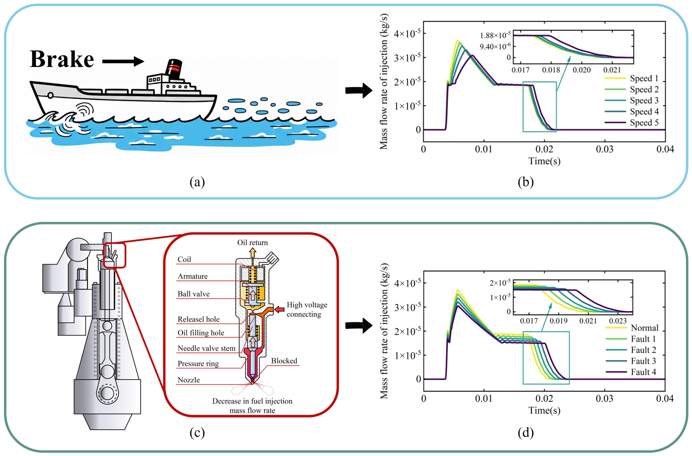
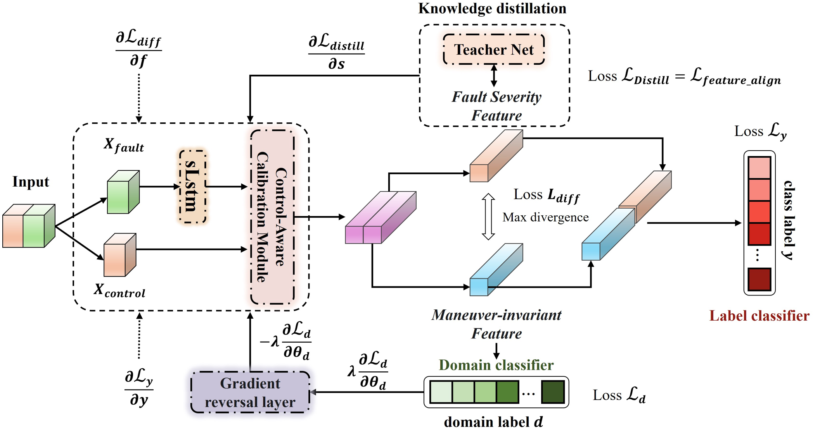

# Control-aware affine network: a novel framework for reliable fault diagnosis of marine diesel engines in dynamic maneuvers

*Congcong Luo, Minghang Zhao\*, Xuyun Fu, Yongjian Zhang, Shisheng Zhong, Song Fu*  
*Harbin Institute of Technology*

[](https://doi.org/10.1080/17445302.2026.2748397)
[](https://zhao62.github.io/Control-Aware-Affine-Network/Control-Aware-Affine-Network-Luo-2026.pdf)
[](https://zhao62.github.io/Control-Aware-Affine-Network/)
[](https://doi.org/10.1080/17445302.2026.2748397)

---

### 📄 Free Full-Text Access (Open-Access Accepted Manuscript)

* **Download Free PDF:** **[Control-Aware-Affine-Network-Luo-2026.pdf](https://zhao62.github.io/Control-Aware-Affine-Network/Control-Aware-Affine-Network-Luo-2026.pdf)**
* **Publisher Version (Version of Record):** [Taylor & Francis Online](https://doi.org/10.1080/17445302.2026.2748397)

> *Copyright Notice: This is an Accepted Manuscript of an article published by Taylor & Francis in Ships and Offshore Structures on 21 Oct 2026, available online: https://doi.org/10.1080/17445302.2026.2748397.*

> **Code & Data Availability Statement:** Due to industrial confidentiality agreements and internal intellectual property protection rules, the proprietary simulation model, datasets, and source code cannot be publicly shared. This page hosts the freely accessible Accepted Manuscript and methodological overview for academic reference.

---

## 🔍 Research Problem: Control-Fault Coupling Under Transient Operations

In real-world **Prognostics and Health Management (PHM)** and **Condition-Based Maintenance (CBM)**, industrial machinery rarely operates at steady state. During dynamic maneuvers (such as vessel braking or deceleration), the Electronic Control Unit (ECU) executes feedforward adjustments—such as extending fuel injection duration—to stabilize combustion. 

Crucially, **early structural faults** (e.g., fuel injector nozzle clogging) trigger nearly identical compensatory extensions, causing two severe failure modes in conventional data-driven diagnostics:
* **False Alarms:** Normal transient control actions are misclassified as component degradation.
* **Missed Early Detections:** Subtle early-stage fault signatures are masked by routine operational micro-adjustments.


*Fig. 1. Injection mass flow rate of diesel engine: (a)–(b) The diesel engine is slowing down; (c)–(d) Diesel engine injector nozzles clogged to varying degrees.*

Existing **Domain Generalization (DG)** approaches typically treat operating-condition shifts as external disturbances to be passively suppressed. **CAAN** introduces a **control-diagnosis coordination** paradigm that transforms real-time control signals from passive noise into **active calibration mechanisms**.

---

## 🧠 Methodology Overview


*Fig. 2. The structure of the proposed CAAN.*

### 1. Control-Aware Calibration (CAC) Module
Inspired by feature-wise affine modulation, the CAC module maps real-time control signals (`X_control`, such as shaft angular velocity, cam speed, and cam position) to incremental scaling (`α`) and offset (`β`) factors. By applying an inverse condition-dependent affine transformation (`Y = α ⊙ X_fault + β`), CAC projects raw monitoring features onto a condition-independent health baseline.

### 2. Dual-Feature Decoupling
To balance cross-domain robustness and fine-grained fault sensitivity, calibrated features are decomposed into two orthogonal channels:
* **Fault Severity Features (via Knowledge Distillation):** An expert Teacher Network trained on the **Fourier Phase Spectrum** captures injection timing delays (grounded in the Fourier shift theorem) and transfers this inductive bias to the student model without extra FFT overhead at inference.
* **Maneuver-Invariant Features (via Adversarial Training):** A Gradient Reversal Layer (GRL) removes residual operating-regime variations across unseen domains.

### 3. Feature Orthogonality Regularization
A cosine-similarity orthogonality constraint enforces separation between fault-severity and maneuver-invariant representations, ensuring complementary feature fusion before classification.

---

## 🌐 Key Findings & Cross-Disciplinary Relevance

In the paper, CAAN is evaluated across unseen **out-of-distribution (OOD)** operating regimes (cross-generalization among acceleration, steady-state, and deceleration maneuvers).

Qualitative Takeaways (see full paper for detailed experiments & visualizations):
* **Effective OOD Generalization:** Jointly leveraging active control calibration and dual-feature decoupling enables reliable fault diagnosis under unseen transient maneuvers.
* **Synergy Over Isolation:** Ablation studies confirm that feature decoupling alone struggles to distinguish closely adjacent fault grades under dynamic shifts, whereas integrating control-aware affine calibration is essential for preserving class separability.
* **Role of Control Dimensionality:** Progressively incorporating multi-dimensional control signals sharpens inter-class cluster boundaries in feature space (as visualized via t-SNE) and reduces confusion between healthy and incipient fault states.

---

## 🔗 Related Work in Our Group

## 🔗 Related Work in Our Group

* **CA-DANN (Transactions of the Institute of Measurement and Control, 2026):** *Fault diagnosis of marine diesel engine via control-aware domain adversarial network: A control-diagnosis collaboration perspective* — [Project Page & Free PDF](https://zhao62.github.io/Control-Aware-Domain-Adversarial-Network/)
* **TSRF (Measurement, 2025):** *Thermodynamic Simulation-assisted Random Forest: Towards explainable fault diagnosis of combustion chamber components of marine diesel engines* — [Project Page & Free PDF](https://zhao62.github.io/Thermodynamic-Simulation-Assisted-Random-Forest/)
* **SDTL (Journal of Power Sources, 2025):** *Deep transfer learning enabled online state-of-health estimation of lithium-ion batteries under small samples across different cathode materials, ambient temperature and charge-discharge protocols* — [Project Page & Free PDF](https://zhao62.github.io/SDTL-Battery-SOH/)
* **BMSFormer (Energy, 2024):** *BMSFormer: An efficient deep learning model for online state-of-health estimation of lithium-ion batteries under high-frequency early SOC data with strong correlated single health indicator* — [Project Page & Free PDF](https://zhao62.github.io/BMSFormer/)

---

## 📝 Citation

If you find this framework or paper useful in your research, please consider citing:

```bibtex
@article{luo2026caan,
  title={Control-aware affine network: a novel framework for reliable fault diagnosis of marine diesel engines in dynamic maneuvers},
  author={Luo, Congcong and Zhao, Minghang and Fu, Xuyun and Zhang, Yongjian and Zhong, Shisheng and Fu, Song},
  journal={Ships and Offshore Structures},
  year={2026},
  publisher={Taylor \& Francis},
  doi={10.1080/17445302.2026.2748397}
}
```

---

## 📬 Contact

For academic inquiries or institutional research collaboration, please contact the corresponding author:  
**Minghang Zhao** (`zhaomh@hit.edu.cn`), Harbin Institute of Technology.

---

**Topics:** `Fault Diagnosis` · `Domain Generalization` · `Out-of-Distribution (OOD)` · `Control-Diagnosis Coordination` · `Knowledge Distillation` · `Fourier Phase Spectrum` · `Condition-Based Maintenance (CBM)` · `PHM` · `Marine Diesel Engines` · `Dynamic Maneuvers`
